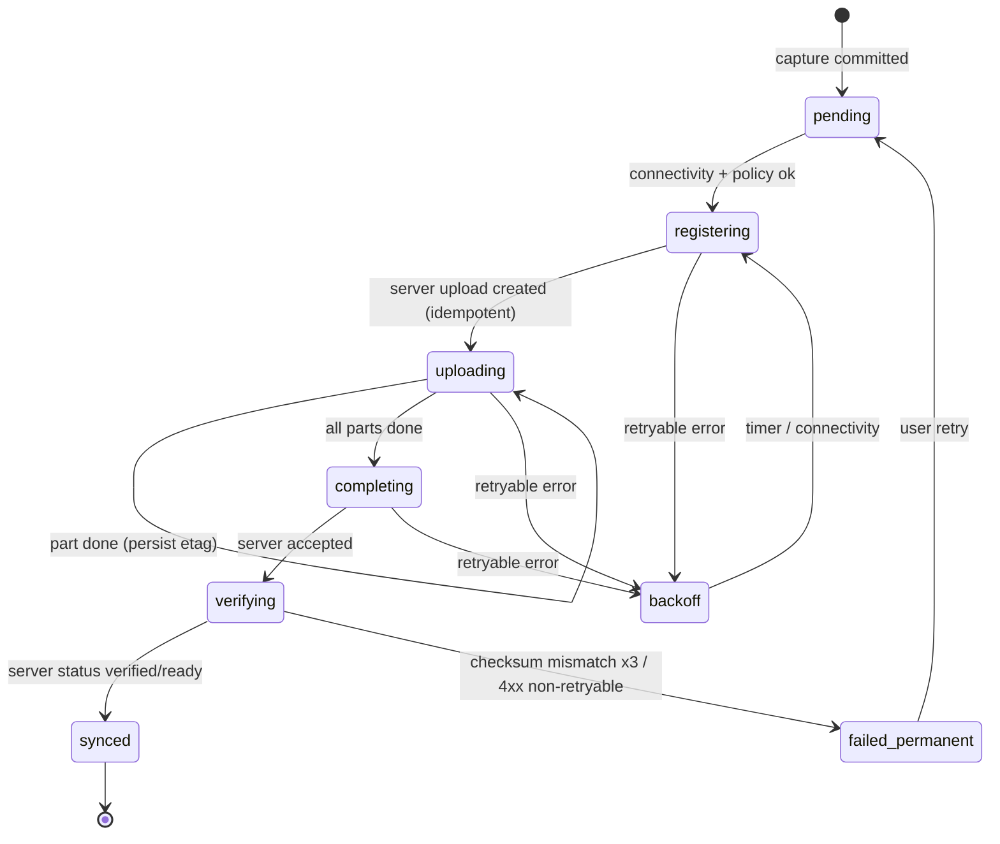

# Offline-First Synchronization

Status: Accepted (pending spikes S4, S5) · Last updated: 2026-09-30 · Related: ADR-0008, ADR-0009, SYNC-001–SYNC-008, NFR-001, NFR-002

## Principles

1. **The local drift DB is the source of truth on the device.** The UI reads only from it.
2. **IDs are client-generated** (UUIDv7) for Memories and assets, so offline-created entities never need re-keying and retries are idempotent.
3. **Media is immutable.** Only metadata can conflict, and media never needs merging.
4. **At-least-once delivery + idempotent server = effectively once.**
5. **Background work is best effort.** The OS decides; correctness never depends on background execution.

## Local schema (drift, planned)

| Table | Purpose | Key columns |
|---|---|---|
| `memories` | Local Memory records | `id` (UUIDv7), `kind`, `captured_at`, `captured_tz`, `experience_id`, `profile_ref`, `settings_json`, `caption`, `favorite`, `location_*` (nullable), `deleted_at`, `server_version`, `dirty_fields` |
| `assets` | Files belonging to Memories | `id`, `memory_id`, `role`, `local_path`, `bytes`, `sha256`, `mime`, `width`, `height`, `duration_ms`, `upload_state` |
| `upload_jobs` | Durable upload queue | `asset_id` (unique), `state`, `attempts`, `next_attempt_at`, `server_upload_id`, `part_size`, `last_error` |
| `upload_parts` | Multipart progress | `asset_id`, `part_number`, `etag`, `state` |
| `outbox` | Pending metadata mutations | `id`, `entity`, `entity_id`, `op`, `payload_json`, `created_at` |
| `sync_state` | Pull cursor, per account | `account_id`, `cursor` |
| `presets`, `settings` | Local configuration | — |

Schema changes use drift migrations with tests for every step (see [testing-strategy.md](../development/testing-strategy.md)).

## Upload state machine (per asset)



- Each transition is persisted **before** the side effect it authorizes is considered done. A restart resumes from the persisted state.
- Retryable: network errors, 5xx, 429 (respect `Retry-After`), expired presigned URL (re-presign). Non-retryable: 400/403/409 with a permanent code. These are surfaced in LIB-004 status.
- Backoff: exponential with full jitter, 5 s base, 30 min cap. Attempts are unbounded for retryable errors (the queue must never silently drop).
- Order: `photo_rendered`, `thumbnail`, and `photo_display` upload before `photo_original` and `motion_clip`, so the Memory is visible on the web quickly. The Memory metadata record is created first.
- Policy: Wi-Fi-only by default (SYNC-005); pause below a low-battery threshold unless charging.

## Background execution

| Platform | Mechanism | Limits |
|---|---|---|
| Android | WorkManager through the `workmanager` plugin (see the implementation section; `background_downloader` was not adopted) | Runs after app kill; OEM battery managers (including Honor/MagicOS) may delay it. S4 verifies correctness on the emulator; OEM delays are field verification FV-005. |
| iOS | BGTaskScheduler app refresh through the `workmanager` plugin (the pass runs the ordinary foreground upload code; no background `URLSession` yet) | The system schedules tasks; each task is a whole request. Resumability comes from **per-part tasks** (see [upload-sync.md](../specs/upload-sync.md)). |

When the app is in the foreground, the queue runner also drives uploads directly.

## Metadata sync

**Push (outbox):** local edits (caption, favorite, delete, location toggle) write to `memories` and append an `outbox` op in the same transaction. The runner sends ops in order with `Idempotency-Key = op.id`. The server applies field-level updates with `If-Match: server_version`. On `409`, the client pulls and re-applies (see the conflict rules).

**Pull (P5 minimal, full in SYNC-006):** `GET /v1/sync/changes?cursor=…` returns changes since a monotonic server `change_seq`, including tombstones. The client upserts and advances the cursor in one transaction.

**Conflict rules:**
- Field-level last-writer-wins by server receipt order. The server assigns versions, so clients never trust their own clocks.
- Delete wins over edit. Restoring from trash is an explicit op.
- Assets never conflict (immutable). A duplicate upload of the same `assetId` is a no-op; a different `assetId` with an identical `sha256` for the same owner is deduplicated server-side by referencing the existing object (SYNC-004).

## Free-up-space (Post, LIB-005)

Only `synced` assets whose checksum was verified server-side may have local originals removed. Thumbnails and display renditions stay. Opening the original then downloads it on demand.

## Implementation (mobile data layer)

Status: implemented and tested on the host and against the real API · Code: `apps/mobile/lib/{data,sync,api}` · Tests: `apps/mobile/test/{data,sync,api,integration}`

**What differs from the plan above**

- `upload_jobs` also stores `resume_state` (the state a backoff returns to), `part_count`, `last_error_code` and `checksum_failures`; `memories` stores `account_id` (null while anonymous), `registered` and `captured_here` (false for Memories mirrored from the server). `outbox` and `sync_state` are as planned. `dirty_fields` was not needed: a pending outbox row is what marks a field as locally edited.
- The schema is version 1. Later versions add an entry to `AppDatabase.extraSteps`; `test/data/db/migration_test.dart` covers the step runner, data preservation, failing steps and the downgrade guard. A database newer than the app is refused (`DatabaseDowngradeError`).
- Server-origin Memories (from other devices, SYNC-006) only mirror assets the server reports as verified; their `sha256` is empty because the API does not return it, and they have no local file.

**Capture → Memory (MEM-001, NFR-002).** `MemoryRepository.commitCapture` hashes each file (SHA-256), moves it into `<media>/<memoryId>/<role>.<ext>`, fsyncs it, then inserts the Memory, its assets and (when signed in) the upload jobs in one transaction. Any failure removes the moved files. A crash between the move and the commit leaves an orphan directory that `recoverOrphans` deletes after a one hour grace period. The call is idempotent per Memory id.

**Upload engine.** `UploadEngine.drain()` implements the state machine above and `docs/specs/upload-sync.md` exactly: register (PUT), create-or-resume, single or multipart transfer with the ETag stored per part before the next step, re-presign on 400/403 (only freshly signed URLs being rejected counts, three in a row is permanent), completion, and polling until the server reports `verified` or `ready`. Backoff is full jitter, 5 s base, 30 min cap, honoring `Retry-After`. A checksum mismatch restarts the upload; the third is `failed_permanent`. `401` pauses the queue (`NeedsSignIn`), a full quota pauses it for an hour (`QuotaExceeded`). Policy: connected, Wi-Fi only by default (SYNC-005), not below 15% battery unless charging. Jobs are partitioned by account and Memories in the trash are skipped.

**Metadata.** `OutboxPusher` sends edits in order per entity (version conflicts re-apply on top of the newer server version; permanent 4xx drops the operation; edits for an unregistered Memory wait). `PullSync` pages the change feed, fetches changed Memories and presets, never overwrites fields with an unsent local edit, lets a server-side delete win, and advances the cursor in the same transaction as the data. `SyncCoordinator.syncOnce()` runs push, upload, push again, pull; `start()` re-runs on connectivity or account changes; `BackgroundScheduler` is the thin OS hand-off (implemented by the WorkManager / BGTaskScheduler adapter below).

**Background execution (SYNC-002).** `BackgroundScheduler` is implemented by `WorkmanagerBackgroundScheduler` (`apps/mobile/lib/platform/background_sync.dart`) on top of the `workmanager` plugin, behind a small `WorkPlanner` seam that tests replace with a fake. It registers two kinds of work, both running one headless sync pass:

- a **periodic** pass `doro.sync.periodic` every 30 minutes (WorkManager's minimum is 15), registered at start-up with the `update` policy. It is the safety net that picks up work after an app kill or a reboot;
- a **one-off** `doro.sync.wakeup`, which `SyncCoordinator` requests for the time the next backed-off job is due (`scheduleWakeUp`) and cancels when the queue is empty (`cancel`).

Constraints given to the OS: a connected network, or an **unmetered** one while "Upload on Wi-Fi only" is on (the setting is read when registering, and the periodic pass is registered again when the setting changes), and *battery not low*. These only avoid pointless wake-ups. The pass enforces the policy again (Wi-Fi only, 15% battery unless charging, SYNC-005) because it uses the same `UploadEngine`. Charging is not required.

`runBackgroundSyncPass` opens its own `DataLayer` (`openDataLayer` in `bootstrap.dart`, without a scheduler, so it never replaces the work item it runs in), calls `syncOnce()`, and always closes it. It returns `false` only for unexpected errors (Android then retries with backoff); network and server failures are handled by the engine. The app and a background pass can have the SQLite file open together, so the executor sets `busy_timeout`; uploads are idempotent (SYNC-004) in case both process the same job. The headless entry point is `backgroundCallbackDispatcher`.

Platform setup: Android needs nothing beyond the plugin's own manifest merge (`INTERNET` and `ACCESS_NETWORK_STATE` were already declared). iOS has `BGTaskSchedulerPermittedIdentifiers` and `UIBackgroundModes: fetch` in `Info.plist` and the periodic task registered in `AppDelegate.swift`.

**Dependency justification (development-guide dependency policy).** `workmanager` 0.10.10 (MIT; Flutter Community organization, releases within the last months; Android and iOS). Necessity: WorkManager and BGTaskScheduler are native APIs that need a platform channel and a headless Flutter engine, far beyond ~100 lines. It adds three federated platform packages (`workmanager_android`, `workmanager_apple`, `workmanager_platform_interface`) plus Linux and web stubs and the AndroidX WorkManager library. `workmanager_android` is also a dev dependency, only so a test can stand in for the plugin's Android implementation. Not a camera API, so ADR-0001 does not apply. It does not replace the ADR-0009 decision for resumable transfers: transfers still run in Dart; the plugin only wakes the app. What the OS really does after an app kill, under Doze or OEM battery managers, and on iOS is unverified: FV-005, FV-015 and FV-016 in [field-verification.md](../development/field-verification.md).

**Running the tests (inside WSL).**

```bash
source scripts/dev-env.sh
cd apps/mobile
flutter test test/data test/sync test/api            # host tests, no network
pnpm infra:up                                         # once, from the repo root (Postgres + Garage)
flutter test test/integration                         # the real API, including 200 MB through 6 network drops and 2 kills
dart run build_runner build                           # after changing lib/data/db/tables.dart
```

`test/integration` starts the real `services/api` through `apps/mobile/tool/test_api_server.ts` (a test-only wrapper that runs jobs in-process and exposes the mailer), so uploads are verified immediately.
